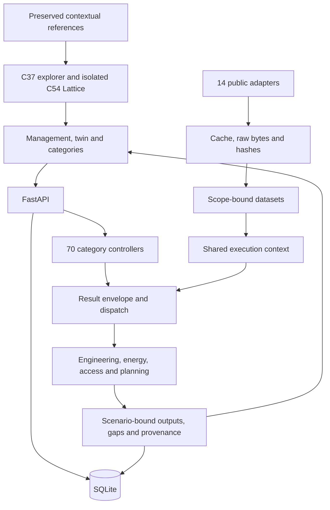

# Architecture

Updated 1 November 2026 against implementation `f3c13f7` and follow-up `3aaa30e`. [Handover](../PROJECT_HANDOVER.md) · [API](API.md) · [category register](CATEGORIES.md).

## Runtime and dispatch

React 19/TypeScript is built with Vite and served by FastAPI on loopback port 8000. Development Vite on 5173 proxies `/api`. SQLite stores projects, immutable input snapshots, source metadata, latest per-snapshot results and hash-linked events. Seventy category controllers dispatch to shared models; 22 agent profiles are configuration/ownership contracts without hosted LLM execution.

| File/area | Responsibility |
|---|---|
| `backend/app.py` | Local/origin guards, routes, execution, previews, readiness, exports and static SPA |
| `backend/store.py` | SQLite schema, snapshot creation, scoped context and events |
| `backend/engine.py` | Result identity, category dispatch and evidence classification |
| `backend/engineering.py` | Input validation, projected AOI geometry, layouts, wind CSV, cubic proxy and baseline finance |
| `backend/providers.py`, `ingestion.py` | Allowlisted retrieval, cache/raw hashes, jobs, source bindings and restart recovery |
| `backend/external_analysis.py` | Source-backed view and specialized-model dispatch |
| `backend/site_data.py` | Coast/port/AIS screening and preferences |
| `backend/overview_data.py` | IEA/DESNZ/Arup extraction and explicit regional energy/LCOE model |
| `backend/wind_history.py`, `accessibility.py` | Monthly wind statistics, matched access criteria and windows |
| `backend/farm_preview.py` | Selected geometry, conceptual layouts and illustrative hub-point wakes |
| `backend/work_packages.py`, `sensitivity.py` | 54 workspace schemas, planning formulas/registers, CPM and C61 sensitivity |
| `backend/references.py`, `supply_reference.py` | Contextual attachment validation and checksums |
| `dashboard/src/main.tsx` | Routing, shared selection, editor, management and category host |
| `TwinPreview.tsx`, `Farm3D.tsx`, `ThreeFarmScene.tsx` | Shared preview/full-twin scene, ocean, labels, controls and disposal |
| `SitePlots.tsx`, `WindHistory.tsx`, `AccessibilityPage.tsx` | C03–C05, C07 and C56 interactive views |
| `WorkPackagePage.tsx`, `ReadinessPage.tsx` | Draft previews, saved evidence/registers and all-category audit |
| `AttachedFarmExplorer.tsx`, `SupplyChainWorkspace.tsx` | C37 comparison and C54 integration |
| `dashboard/public/assets/lattice/` | Local renderer, pure core, data, D3 libraries and licenses |
| `config/`, `categories/`, `agents/`, `presets/` | Stable registries, contracts, profiles and strategies |
| `sources/`, `reports/`, `docs/`, `tests/`, `scripts/` | Originals, milestone records, guides and verification |

Frontend filenames without a directory are under `dashboard/src/`. [Operations](OPERATIONS.md) describes runtime data and backups.

## Revision and selection semantics

Scenario UUID/hash binds project, site, layout, input values and method version. Revision numbers increment per project; result site/layout revision fields currently use that number. New inputs, restored designs and newly attached evidence create snapshots. Region/AOI/reference-point changes clear incompatible geometry or data; `attached_data()` verifies provider/project/site/AOI/point identity.

Management, embedded twin, full twin and category pages share the selected scenario. URLs retain `?scenario=...`, saved selection is project-specific, storage events synchronize other tabs, and loads reject mismatched project/scenario identity. C54 uses this outer selection while its directory remains shared contextual evidence.

Input dictionaries merge at the top level, not recursively. API clients must pass site/layout explicitly and preserve the complete `category_inputs` map when replacing one category. Draft workspace/access/farm-preview evaluations do not save revisions. Saving workspace inputs creates a revision and recomputes supported views.

Results are keyed by scenario/category. A same-snapshot rerun replaces its cached result and processed payload; run events remain. Full per-run result retention, independent site/layout counters, selective dependency invalidation and atomic whole-project publication remain future work. Batch screening shares scope/context/cache and commits individual category results; it is not distributed agent orchestration.

## Scientific model boundaries

- Shapely validates polygons, with a local azimuthal-equidistant metric projection for regional geometry. Rotor envelopes must fit AOI/exclusions. Seeded feasible-point placement is not an energy/cost optimizer.
- Wind is meteorological FROM, clockwise from north, with explicit UTC. C10 already fits a two-parameter Weibull by moments to positive speeds, retaining calm mass. Descriptive fitting is separate from correlated or bankable yield uncertainty.
- Imported matching-height wind uses a labelled cubic proxy. The explicit regional case uses 2021–2025 ERA5, declared 100-to-150 m extrapolation, the theoretical IEA curve and sequential losses, annualized to 8,760 hours. Do not silently mix these paths.
- Exceedance estimates need explicit uncertainty. Weather-year spread and deterministic cases are not P90. Consistent-real-price-year cost/energy discounting gives LCOE; captured price affects revenue and NPV.
- C56 uses eligible/ineligible/unknown states and overlapping continuous-window starts. Hub wakes and the ocean shader provide no wave-shelter or vessel-access credit.
- C54 preserves the supplied confidence-weighted exposure model. Directory capability links are neither vendor qualification nor delivery forecasts. See [C54 methods](../reports/c54_lattice_workspace.md).

## Contextual HTML isolation

C37 parses embedded JSON and rebuilds the view in React without executing the original HTML. C54 retains the reviewed renderer in a sandboxed local iframe without same-origin access; CSP blocks connections/forms and D3 libraries are local. Directory profiles open only on explicit selection. The original HTML is preserved and downloaded as an attachment. Git preserves original/bundle bytes for checksum verification. Neither attachment is a fourteenth adapter or an official assessment source.

## Environmental spatial derivatives

`environment_screening` supplies C16/C48/C49/C50 through `backend/environment.py`. Full-resolution geometry supports disc metrics; simplified GeoJSON supports interactive display and explicitly approximate AOI intersections. The selected compatible binding determines the dataset; no global newest-dataset fallback exists. Optional rayshader products are cached under canonical terrain SHA-256 with product hashes; an allowlisted API serves them. Three.js uses the same source grid and keeps visual exaggeration separate from numerical evidence. Missing cells remain unavailable. C48–C50 retain their editable register under `evidence_workspace`, while readiness classifies the bound map as source screening. [Implementation](../reports/environmental_atlas.md).
